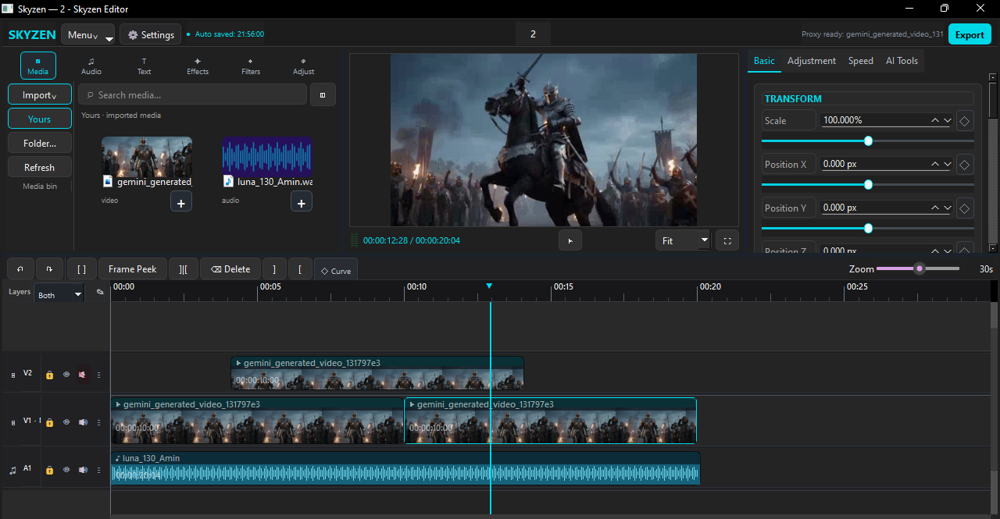

# Skyzen

**A community-built desktop video editor — free for non-commercial use.**

Skyzen is a Windows desktop video editor built with Python and PySide6. It includes a project library, a multitrack timeline, media preview, editing controls, and FFmpeg-based media processing.

Skyzen is developed as a community project. Bug reports, documentation, testing, accessibility feedback, and code contributions are welcome.

> **License:** Skyzen uses the Skyzen Community Non-Commercial License (SCNCL) 1.0. You may use, study, modify, and share Skyzen for non-commercial purposes under its terms. Selling Skyzen, paid builds, premium upgrades, or paid access to modified versions is prohibited. This is source-available software, not an OSI-approved open-source license. Read [LICENSE.md](LICENSE.md).

## Screenshots




## What is included

- Python source code and modular editor panels
- Project library, create/open/rename, and Trash Bin workflows
- Multitrack timeline and clip editing
- Media preview and export UI
- Tests and historical development notes
- Windows setup and launch scripts
- Privacy, security, licensing, and contribution documentation

Features and reliability may vary by build. Keep backups and test on copies of important projects.

## Requirements

- Windows 10 or Windows 11
- Python 3.10 or newer
- Python packages listed in `requirements.txt`
- FFmpeg **and** FFprobe installed separately and available on `PATH`

Skyzen does not bundle or silently download FFmpeg. Obtain FFmpeg from a trusted source, review the license for the exact build and codecs you install, and follow its terms.

## Quick start on Windows

1. Download or clone this repository.
2. Install Python 3.10+ from a trusted source and ensure the Python launcher (`py`) or `python` command is available.
3. Install FFmpeg and FFprobe separately and ensure `ffmpeg -version` and `ffprobe -version` work in a new terminal.
4. Double-click `setup.bat` once to create the local `.venv` and install Python dependencies.
5. Double-click `run.bat` to launch Skyzen without keeping a console open. You can also double-click `silent.vbs`.
6. If launch fails, run `run_debug.bat` to see the error output.

Manual setup:

```bat
py -3 -m venv .venv
.venv\Scripts\python.exe -m pip install --upgrade pip
.venv\Scripts\python.exe -m pip install -r requirements.txt
.venv\Scripts\python.exe main.py
```

Check FFmpeg:

```bat
ffmpeg -version
ffprobe -version
```

## Privacy and local storage

Skyzen's Python application code in this snapshot is not designed to collect or transmit users' project content, source media, or usage analytics. Project metadata, settings, trash items, thumbnails, caches, and crash logs may be stored locally. Media may be referenced by its original path rather than copied into a project.

Do not share project files or crash logs without checking them for personal paths or other private information. Third-party software and services have their own behavior and privacy policies. See [PRIVACY.md](PRIVACY.md).

## Contributing

Please read [CONTRIBUTING.md](CONTRIBUTING.md) and [CODE_OF_CONDUCT.md](CODE_OF_CONDUCT.md). Focused pull requests, reproducible bug reports, tests, documentation, and accessibility improvements are welcome. Please do not upload `.venv`, personal project data, media files, secrets, or generated builds.

Run the test suite from the repository root:

```bat
.venv\Scripts\python.exe -m unittest discover -s tests -t .
```

Automated tests do not replace a real Windows GUI test with representative video, audio, and image files.

## Development history

Historical files named `README_*`, `CHANGELOG_*`, `PATCH_*`, and `SKYZEN_VERIFIED_FIX_HISTORY_*` are retained as a development trail. They describe work in progress and are not a guarantee that every intermediate build was stable or released.

See [docs/PROJECT_HISTORY.md](docs/PROJECT_HISTORY.md) and [docs/ARCHITECTURE.md](docs/ARCHITECTURE.md).

## Support the creators

If Skyzen is useful to you, please support the creative projects:

- **BRONVEIL** — [YouTube](https://www.youtube.com/@bronveil)
- **S7XIAN** — [YouTube](https://www.youtube.com/@s7xian)

Their music may also be available on other streaming platforms, depending on region and platform availability. Their listing here is community/creative recognition and does not claim specific code authorship unless documented.

## Third-party material

The Skyzen license does not override third-party licenses. In particular, `docs/concat_reference/` contains reference source files that identify an upstream AGPL-3.0-or-later license. They are reference-only and are not compiled into Skyzen. Review [docs/THIRD_PARTY_AUDIT.md](docs/THIRD_PARTY_AUDIT.md) before redistribution or reuse, and preserve all upstream notices. Third-party Python packages and FFmpeg also have their own licenses.

## Important files

- `LICENSE.md` — full Skyzen license
- `COMMUNITY_LICENSE_NOTICE.md` — short license summary
- `CONTRIBUTING.md` — contributor workflow
- `CONTRIBUTORS.md` — community and creative acknowledgements
- `PRIVACY.md` — local data and privacy notes
- `SECURITY.md` — security reporting guidance
- `requirements.txt` — Python dependencies
- `setup.bat`, `run.bat`, `silent.vbs` — Windows setup and launch
- `docs/THIRD_PARTY_AUDIT.md` — third-party review checklist


